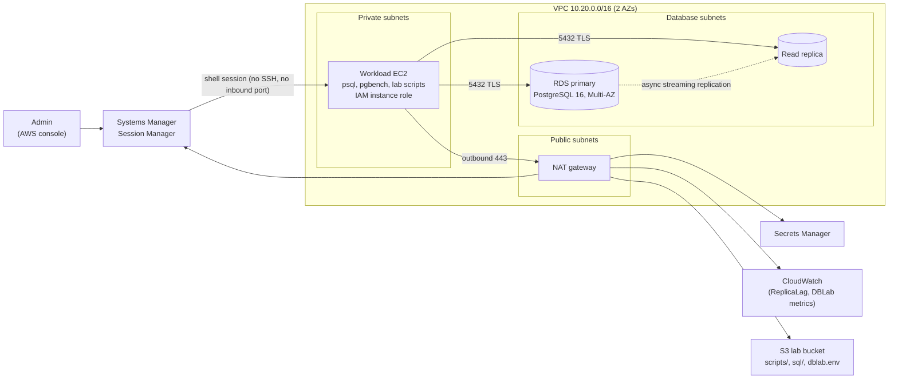

# PostgreSQL operations on AWS RDS

  

A hands-on lab that runs a production-style PostgreSQL deployment on AWS and works through the day-to-day DBA/DevOps tasks on it: query tuning, partitioning, vacuum and bloat, replication, failover testing and automated backup validation. The infrastructure is plain Terraform (no modules), so every VPC, route, security group and IAM statement is visible.

Part of a three-project series:
1. **PostgreSQL operations on RDS** (this repo)
2. [Three-tier app on ECS Fargate with Aurora and RDS Proxy](https://github.com/monahgh/aws-three-tier-ecs-aurora)
3. [EKS with CloudNativePG, Multi-AZ RDS and serverless](https://github.com/monahgh/aws-eks-cloudnativepg-serverless)

## What it demonstrates

| Area | What the lab covers |
|---|---|
| Performance | Finding slow queries with `pg_stat_statements`, reading `EXPLAIN (ANALYZE, BUFFERS)`, choosing the right index (FK, composite, covering, partial, expression), `work_mem` and sort spills |
| Data lifecycle | Range partitioning, planning-time and run-time partition pruning, instant retention by dropping partitions |
| Maintenance | MVCC and dead tuples, `VACUUM` vs `VACUUM FULL`, HOT updates and `fillfactor`, autovacuum tuning, the xmin horizon |
| High availability | Async read replica vs synchronous Multi-AZ standby, replication lag monitoring, a scripted Multi-AZ failover test |
| Recoverability | Automated backup validation: snapshot, restore, verify a canary row and row counts, publish a metric, clean up |
| Secure access | No SSH and no inbound ports: Session Manager with a least-privilege instance role, credentials from Secrets Manager |

## Architecture



The SSM agent on the private instance opens an outbound HTTPS connection through the NAT; the Session Manager shell is tunneled back over that connection, so the instance needs no inbound rules at all. An editable diagram is in [docs/architecture.drawio](docs/architecture.drawio).

| Component | Details |
|---|---|
| VPC | 10.20.0.0/16, public / private / database subnets across 2 AZs, 1 NAT gateway |
| RDS primary | PostgreSQL 16, `db.t4g.micro`, Multi-AZ, encrypted, not publicly accessible |
| Read replica | Async replica of the primary (`replicate_source_db`), encrypted |
| Workload EC2 | Private subnet, no public IP, no inbound rules; reached through Session Manager |
| Lab bucket | Terraform uploads `scripts/`, `sql/` and a generated `dblab.env` |
| Credentials | Secrets Manager secret, read at runtime by the scripts |

## Design decisions

| Decision | Why |
|---|---|
| Session Manager instead of SSH or a bastion | No inbound ports or keys; every session is IAM-authorised and logged in CloudTrail |
| Least-privilege instance role | Secret read limited to one secret, S3 read to one bucket; `rds:Delete*` limited to `pgops-lab-validate-*` ARNs, so the backup script can only delete what it created; reboot limited to the primary |
| AMI from the AWS SSM public parameter | The name-filter lookup can match the *minimal* AL2023 image, which has no SSM agent |
| Scripts shipped through S3 by Terraform | `fileset()` + `for_each` with `etag = filemd5()`: one apply re-uploads only changed files; `dblab.env` is generated from Terraform values, so nothing is hardcoded on the instance |
| Both a read replica and Multi-AZ | Shows the difference: the replica is async, readable and promoted manually; the Multi-AZ standby is synchronous, not readable and fails over automatically |
| Explicit `storage_encrypted` on the replica | It is inherited from the primary, but leaving it unset made Terraform plan a replacement |
| Plain resources, no modules | Makes every networking and IAM building block explicit |
| Lab cost settings | 1 NAT gateway, 1-day backups, no final snapshot, small Graviton DB instances |

## Repository layout

```text
terraform/   VPC, subnets, NAT, security groups, EC2, RDS primary + replica, IAM, lab bucket
scripts/     setup_workload.sh, replication_check.sh, failover_test.sh, backup_validate.sh, pgbench_load.sh
sql/         01_query_tuning, 02_partitioning, 03_vacuum_bloat, 04_replication
bootstrap/   create / delete the S3 bucket for Terraform state
docs/        architecture diagram, step-by-step walkthrough
```

## Deploy

Prerequisites: AWS CLI v2, Terraform >= 1.5, an IAM admin profile (not root).

```bash
export AWS_PROFILE=lab

# 1. State bucket (once per account): versioned, encrypted, S3 native locking
bash bootstrap/create_state_bucket.sh

# 2. Database credentials: create the secret the stack reads
aws secretsmanager create-secret --region eu-central-1 \
  --name pgops-lab/postgres/password \
  --secret-string '{"username":"postgresadmin","password":"<choose-a-password>"}'

# 3. Backend config (gitignored) and apply
cd terraform
cp backend.hcl.example backend.hcl    # set your account ID
terraform init -backend-config=backend.hcl
terraform plan -out=tfplan
terraform apply tfplan
terraform output workload_bootstrap_command
```

Then, in EC2 console -> `pgops-lab-workload` -> Connect -> Session Manager, paste the `workload_bootstrap_command` output and run `bash -l`. The setup installs psql/pgbench/jq, seeds pgbench (scale 10, 1M accounts) and starts a background `pgbench-load.service` (4 clients, 20 TPS) that reconnects after failovers.

| Helper | Effect |
|---|---|
| `use_primary` / `use_replica` | Export `PG*` variables for the primary or the replica (password fetched from Secrets Manager) |
| `labsync` | Pull the latest scripts and SQL from the lab bucket |
| `sudo journalctl -u pgbench-load -f` | Watch the background load |

## Exercises

All commands run on the workload server. [docs/WALKTHROUGH.md](docs/WALKTHROUGH.md) explains each step in depth.

| # | Command | What it shows |
|---|---|---|
| 1 | `use_primary && psql -f /opt/dblab/sql/01_query_tuning.sql` | Seq Scan to Index Scan; FK delete cost without a child-side index; composite index order removing a Sort; `Index Only Scan` with `Heap Fetches: 0`; partial index size; sort spill to disk vs memory; unused and redundant indexes |
| 2 | `psql -f /opt/dblab/sql/02_partitioning.sql` | Planning-time pruning (one partition in the plan), run-time pruning (`Subplans Removed`), dropping the oldest partition instantly |
| 3 | `psql -f /opt/dblab/sql/03_vacuum_bloat.sql` | Dead tuples after mass updates; `VACUUM` keeps the size, `VACUUM FULL` shrinks it; HOT updates with `fillfactor 70` vs 100; a long transaction holding back cleanup |
| 4 | `psql -f /opt/dblab/sql/04_replication.sql` on the primary, then on the replica | Replica listed as `async` in `pg_stat_replication`; marker row visible on the replica; writes rejected on the replica |
| 5 | `bash /opt/dblab/scripts/replication_check.sh` | Lag from SQL views and the CloudWatch `ReplicaLag` metric; non-zero exit above a threshold (usable as a check) |
| 6 | `bash /opt/dblab/scripts/failover_test.sh` | Reboot with failover: primary and standby AZs swap; the script measures write unavailability and shows the server IP change |
| 7 | `bash /opt/dblab/scripts/backup_validate.sh` | Snapshot, restore to a temporary instance, canary and row-count checks, restore time as RTO evidence, `DBLab/BackupValidation` metrics, guaranteed cleanup |

## Lessons learned

- **An instance profile is not optional for Session Manager.** The first apply created the instances without one; the SSM agent had no credentials, never registered, and the private databases were unreachable. Adding a role through an instance profile fixed it in place without recreating the instance.
- **CRLF breaks shell scripts on Linux.** `.gitattributes` forces LF for `*.sh`, `*.sql` and `*.env`.
- **`most_recent = true` AMI lookups plan replacements** when a new image is published. Pin the AMI or use `lifecycle { ignore_changes = [ami] }` for long-lived instances.

## Production changes

- `manage_master_user_password = true` (RDS-managed, rotatable secret, never in Terraform state). The lab reads a pre-created secret, so the password is visible in state; the other two projects in the series use the managed secret.
- VPC endpoints for SSM, Secrets Manager and S3 instead of a NAT gateway; one NAT per AZ if NAT is needed.
- Custom parameter group (`log_min_duration_statement`, `track_io_timing`), Performance Insights, gp3 storage.
- CloudWatch alarms on replica lag, CPU, free storage and `MaximumUsedTransactionIDs`.
- Deletion protection, longer backup retention, final snapshots.

## Cost and teardown

Roughly **$0.13/hour** in eu-central-1 while running (Multi-AZ primary, replica, NAT gateway, one `t3.micro`). Each `backup_validate.sh` run adds a `db.t4g.micro` for ~20-30 minutes.

```bash
cd terraform && terraform destroy
aws secretsmanager delete-secret --region eu-central-1 \
  --secret-id pgops-lab/postgres/password --force-delete-without-recovery
```

Afterwards, check that no `pgops-lab-validate-*` instances or snapshots are left. Delete the state bucket last with `bash bootstrap/delete_state_bucket.sh` (it removes every object version; skip it if other projects still use the bucket).

## Troubleshooting

| Symptom | Cause | Fix |
|---|---|---|
| Session Manager "Connect" greyed out | Agent has not picked up the role yet | Wait 2-3 minutes, or reboot the instance once |
| `use_primary: command not found` | Session Manager starts plain `sh` | Run `bash -l` |
| `AccessDenied` on `aws s3 sync` | IAM policy change not applied yet | `terraform apply`, wait ~30 s |
| psql hangs connecting | Security group does not allow the source | `pgops-lab-database-sg` must allow `pgops-lab-workload-sg` on 5432 |
| `pg_stat_statements_reset` permission error | Needs an elevated role on RDS | Harmless; the lab continues |
| Backup validation fails at restore with AccessDenied | Identifier does not match `pgops-lab-validate-*` | Keep `VALIDATE_PREFIX` from `dblab.env` |
| `$'\r': command not found` | Script saved with Windows line endings | Re-save as LF, `terraform apply`, `labsync` |
